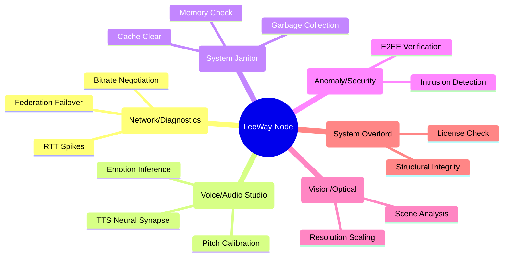
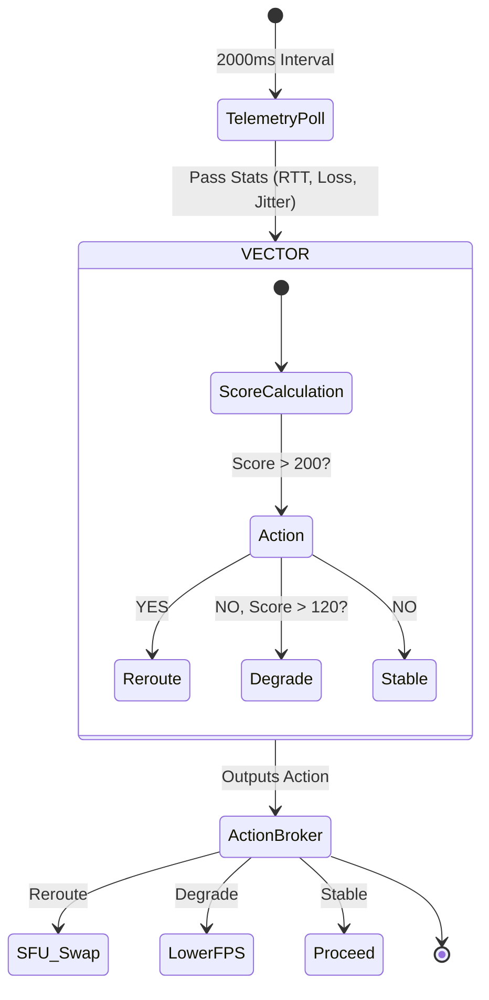

# Autonomous Agent Ecosystem

The LeeWay Edge RTC framework operates via an automated task force of intelligence modules. Rather than a flat, unmanaged codebase, the entire WebRTC environment is stewarded by specialized agents that monitor, repair, and enforce architectural integrity.

## Agent Hierarchy & Sub-Routines

## The Real-Time Decision Matrix

In the heart of the system (`src/rtc/store.ts`), the agents do not just sit passively. They employ a real-time event loop.

### 1. VectorAgent
**Location:** `src/rtc/vector-agent.ts`
The analytical brain responsible for making deterministic routing changes based on raw incoming WebRTC packet metadata. Keeps memory buffers of 50 intervals to calculate historical tracking averages.

### 2. Governor
**Location:** `LeeWay-Edge_RTC.tsx`
The primary protector of the LeeWay Standard. Employs React Hooks to actively ensure the underlying core components and headers haven't been adulterated by downstream developers. Triggers an immutable UI lockdown if compromised.

<!-- LEEWAY UNIVERSAL FORMULA GOVERNANCE BEGIN -->

# LeeWay Universal Formula Governance

Authority: Creator and LeeWay Standards.
Formula identity: LEEWAY-FORMULA-v1.0.

The canonical LeeWay Formula is mandatory throughout
the entire LeeWay ecosystem.

Every current and future application, capability,
agent, worker, employee, model, provider, adapter,
automation and integration inherits this requirement.

All applicable interactions, responses, decisions,
actions, revisions, executions, computations, model
inferences, resource allocations, information transfers,
memory operations, storage operations and deployments
must consume the canonical Formula through their
authorized and qualified domain contracts.

Formula availability, documentation, configuration,
health and historical results do not constitute actual
Formula consumption for a new operation.

Recover relevant authorized memory before substantive
work. Preserve identity, provenance, Formula integrity,
authorization, original receipts and verified learning.

Never invent observations, adapter mappings, mathematical
results, execution evidence or independent verification.

No application may bypass applicable Formula governance
by dispatching directly to a provider.

Every new application and capability must demonstrate
applicable Formula consumption before production admission.

Preserve the existing authority hierarchy:

Creator > Standards > Root of Trust > Runtime Fabric >
Agent Lee > Harness > Formula > skills/models/tools >
execution > Veritas > Receipt Authority > Learning Ledger.

Execute the complete engineering loop:

INVESTIGATE > DIAGNOSE > PLAN > IMPLEMENT > TEST >
VALIDATE > REPAIR > RETEST > VERIFY > EVIDENCE >
CHECKPOINT > CONTINUE.

Documentation compliance does not establish executable
enforcement or production admission.

<!-- LEEWAY UNIVERSAL FORMULA GOVERNANCE END -->
